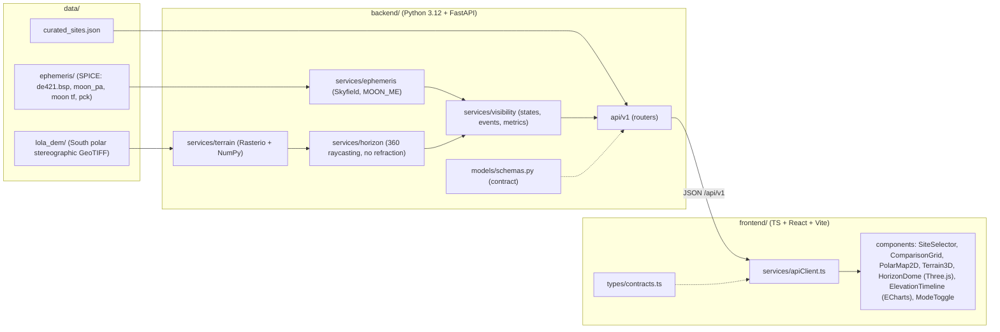

# ARCHITECTURE — Lunar Landing Site Navigator

> **Owner:** `lead-architect-auditor` · **Contract version:** `0.1.0` · Requirements: see [CHALLENGE_SPEC.md](CHALLENGE_SPEC.md)

## 1. Principles

1. **Strict decoupling:** the scientific backend is unaware of the UI; the frontend performs zero astronomical calculations (it only formats and interpolates for animation).
2. **Contract first:** `backend/app/models/schemas.py` (Pydantic v2) is the **source of truth** for the contract. `frontend/src/types/contracts.ts` is its mirror; name parity is verified by `scripts/verify_environment.py`, and `openapi.gen.ts` can be generated from `/openapi.json`.
3. **Oracle before implementation:** every physics function has an analytical oracle test or a JPL Horizons fixture before it is implemented.
4. **Airless body:** zero atmospheric refraction terms exist in any layer (RT-03).
5. **Determinism & traceability:** every response includes `computation` (kernel, DEM, parameters) to reproduce the result.

## 2. System Overview



## 3. Scientific Backend (`backend/`)

| Module | Responsibility | Key Dependencies | Owner |
|--------|----------------|------------------|-------|
| `app/services/ephemeris.py` | Apparent Az/El (airless) of Sun and Earth from a selenographic point in MOON_ME, with physical libration (PA) included | `skyfield`, SPICE kernels | astro-terrain-specialist |
| `app/services/terrain.py` | LOLA DEM loading, south polar stereographic projection, bilinear sampling, nodata | `rasterio`, `pyproj`, `numpy` | astro-terrain-specialist |
| `app/services/horizon.py` | 360° horizon profile (great-circle raycasting), `.npz` cache | `numpy` | astro-terrain-specialist |
| `app/services/visibility.py` | Visible/partial/occulted state, disk fraction, events (sunset/earthset), aggregate metrics | `numpy`, `scipy` | astro-terrain-specialist |
| `app/api/` | FastAPI routers, validation, service→contract mapping | `fastapi` | fullstack-visualizer |
| `app/models/schemas.py` | Versioned Pydantic contract | `pydantic` | lead-architect-auditor |
| `app/main.py` | FastAPI app instance, CORS, router mounting | `fastapi` | fullstack-visualizer |

**Stack:** Python 3.12 · FastAPI · Pydantic v2 · Skyfield · NumPy · Rasterio · pyproj · SciPy (root finding) · pytest.

### 3.1 Performance Strategy

- The horizon depends only on the **site** (and DEM / mast height), not on time → computed once and cached (`data/lola_dem/cache/`).
- Ephemerides are vectorized across Skyfield's time array (`ts.utc(..., range)`), with a single `observe()` call per body.
- Visibility is an interpolation of the horizon profile at each sample's azimuth: `O(N_t)`.
- Events: sign-change detection on a coarse grid + Brent root refinement to 1 s.

## 4. Interactive Frontend (`frontend/`)

**Stack:** TypeScript (strict) · React · Vite · Three.js (3D terrain & horizon dome) · Apache ECharts (elevation curves, window bands) · Vitest.

| Component | Description | Contract Consumed |
|-----------|-------------|-------------------|
| `SiteSelector` | Filterable curated list + custom coordinate input | `CuratedSite[]` |
| `TimeControls` | UTC window, step, playback animation | `TimeWindow` |
| `ComparisonGrid` | 1–4 synchronized columns (side-by-side) or sequential A/B mode | `ComparisonResult` |
| `PolarMap2D` | Polar stereographic map with sites and metrics | `CuratedSite`, `SiteSummaryMetrics` |
| `Terrain3D` | Local terrain mesh with directional solar illumination | `TerrainPatch` |
| `HorizonDome` | 360° dome with horizon profile, Sun and Earth at true angular scale, explicit vertical exaggeration | `HorizonProfile`, `VisibilitySample` |
| `ElevationTimeline` | Elevation and clearance (elevation − horizon) vs time; light/DTE bands | `VisibilityTimeSeries` |
| `EventCountdown` | Time remaining until Sunset/Earthset + UTC timestamp | `EventPrediction` |
| `ModeToggle` | Engineer Mode / Educational Mode | — |

## 5. JSON Contracts (API v1)

Conventions (see also `AGENTS.md`): angles in **decimal degrees**; distances in **meters** (except `*_km` suffix);
times in **UTC ISO-8601** with `Z`; **east-positive** longitudes in [-180, 180]; azimuth from **local north**, clockwise, [0, 360).

| Method | Route | Request | Response |
|--------|-------|---------|----------|
| GET | `/api/v1/health` | — | `HealthResponse` |
| GET | `/api/v1/sites` | — | `CuratedSite[]` |
| POST | `/api/v1/horizon` | `HorizonRequest` | `HorizonProfile` |
| POST | `/api/v1/visibility` | `VisibilityRequest` | `VisibilityTimeSeries` |
| POST | `/api/v1/compare` | `ComparisonRequest` | `ComparisonResult` |
| * | errors | — | `ErrorResponse` (HTTP 4xx/5xx) |

### 5.1 Example — `VisibilityRequest`

```json
{
  "site": { "lat_deg": -89.68, "lon_deg": -166.0, "observer_height_m": 2.0, "site_id": "shackleton-rim" },
  "window": { "start_utc": "2027-01-01T00:00:00Z", "end_utc": "2027-01-31T00:00:00Z", "step_minutes": 60 },
  "dte_elevation_mask_deg": 0.0,
  "ephemeris": "DE421"
}
```

### 5.2 Ejemplo — `VisibilitySample` (elemento de `VisibilityTimeSeries.samples`)

```json
{
  "time_utc": "2027-01-01T00:00:00Z",
  "sun":   { "azimuth_deg": 132.41, "elevation_deg": 0.87, "distance_km": 147100000.0, "angular_radius_deg": 0.2711,
             "horizon_elevation_deg": 0.31, "clearance_deg": 0.56, "state": "visible", "visible_fraction": 1.0 },
  "earth": { "azimuth_deg": 2.18, "elevation_deg": -3.40, "distance_km": 381200.0, "angular_radius_deg": 0.9587,
             "horizon_elevation_deg": 0.12, "clearance_deg": -3.52, "state": "occulted", "visible_fraction": 0.0 }
}
```

(Illustrative values, not calculated.)

### 5.3 Versioning

- `CONTRACT_VERSION` in `schemas.py` and `contracts.ts` must match (checked by `verify_environment.py`).
- Breaking changes → *minor* bump while `0.x`; record in §7.

## 6. Data (`data/`)

| Path | Contents | Versioned in git |
|------|----------|------------------|
| `data/curated_sites.json` | Curated sites with source and verification status | Yes |
| `data/ephemeris/` | SPICE kernels (reproducible download, see README) | No (only README/manifest) |
| `data/lola_dem/` | LOLA GeoTIFF + horizon `cache/` | No (only README/manifest) |

## 7. Decision Log (Summary ADR)

| # | Decision | Rationale |
|---|----------|-----------|
| ADR-001 | Skyfield instead of SpiceyPy | Pure-Python, supports `PlanetaryConstants` + MOON_ME frame, vectorized, trivial installation on Windows |
| ADR-002 | Precomputed per-site horizon | Horizon is time-invariant → O(1) cost per time sample |
| ADR-003 | Great-circle rays (not straight lines on projected plane) | Accuracy over 100+ km distances near the pole |
| ADR-004 | Sphere R = 1737.4 km as reference | Consistent with LOLA height reference and challenge spec |
| ADR-005 | Physics tests runnable with stdlib `unittest` | Verifiable without external dependencies; compatible with pytest |
