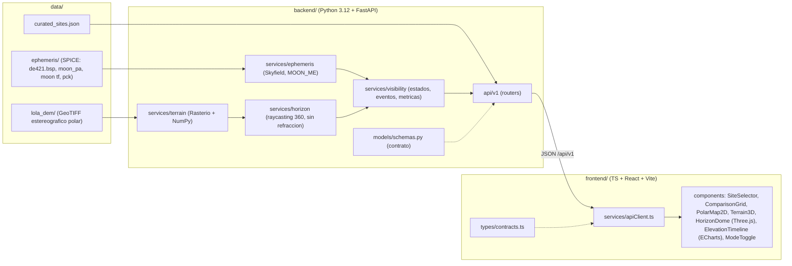

# ARCHITECTURE — Lunar Landing Site Navigator

> **Propietario:** `lead-architect-auditor` · **Versión de contrato:** `0.1.0` · Requisitos: ver [CHALLENGE_SPEC.md](CHALLENGE_SPEC.md)

## 1. Principios

1. **Desacoplamiento estricto:** el backend científico no conoce la UI; el frontend no realiza cálculos astronómicos (solo formatea e interpola para animación).
2. **Contrato primero:** `backend/app/models/schemas.py` (Pydantic v2) es la **fuente de verdad** del contrato. `frontend/src/types/contracts.ts` es su espejo; la paridad de nombres la comprueba `scripts/verify_environment.py` y, en Sprint 2, se generará `openapi.gen.ts` desde `/openapi.json`.
3. **Oráculo antes que implementación:** toda función física tiene un test de oráculo analítico o una fixture de JPL Horizons antes de ser implementada.
4. **Sin atmósfera:** no existe ningún término de refracción en ninguna capa (RT-03).
5. **Determinismo y trazabilidad:** cada respuesta incluye `computation` (kernel, DEM, parámetros) para reproducir el resultado.

## 2. Vista general



## 3. Backend científico (`backend/`)

| Módulo | Responsabilidad | Dependencias clave | Propietario |
|--------|-----------------|--------------------|-------------|
| `app/services/ephemeris.py` | Az/El aparentes (sin refracción) de Sol y Tierra desde un punto selenográfico en MOON_ME, con libración física (PA) incluida | `skyfield`, kernels SPICE | astro-terrain-specialist |
| `app/services/terrain.py` | Carga de DEM LOLA, proyección estereográfica polar, muestreo bilineal, nodata | `rasterio`, `pyproj`, `numpy` | astro-terrain-specialist |
| `app/services/horizon.py` | Perfil de horizonte 360° (raycasting sobre círculos máximos), caché `.npz` | `numpy` | astro-terrain-specialist |
| `app/services/visibility.py` | Estado visible/parcial/oculto, fracción de disco, eventos (sunset/earthset), métricas agregadas | `numpy`, `scipy` | astro-terrain-specialist |
| `app/api/` | Routers FastAPI, validación, mapeo servicio→contrato | `fastapi` | fullstack-visualizer |
| `app/models/schemas.py` | Contrato Pydantic versionado | `pydantic` | lead-architect-auditor |
| `app/main.py` | Instancia FastAPI, CORS, montaje de routers | `fastapi` | fullstack-visualizer |

**Stack:** Python 3.12 · FastAPI · Pydantic v2 · Skyfield · NumPy · Rasterio · pyproj · SciPy (búsqueda de raíces) · pytest.

### 3.1 Estrategia de rendimiento

- El horizonte depende solo del **sitio** (y del DEM/altura de mástil), no del tiempo → se calcula una vez y se cachea (`data/lola_dem/cache/`).
- Las efemérides se vectorizan sobre el vector de tiempos de Skyfield (`ts.utc(..., range)`), un único `observe()` por cuerpo.
- La visibilidad es una interpolación del perfil en el acimut de cada muestra temporal: `O(N_t)`.
- Eventos: detección de cambio de signo en malla gruesa + refinamiento (Brent) a 1 s.

## 4. Frontend interactivo (`frontend/`)

**Stack:** TypeScript (strict) · React · Vite · Three.js (terreno 3D y cúpula de horizonte) · Apache ECharts (curvas de elevación, bandas de ventanas) · Vitest.

| Componente | Descripción | Contrato consumido |
|------------|-------------|--------------------|
| `SiteSelector` | Lista curada filtrable + entrada de coordenadas personalizadas | `CuratedSite[]` |
| `TimeControls` | Ventana UTC, paso, reproducción/animación | `TimeWindow` |
| `ComparisonGrid` | 1–4 columnas sincronizadas (lado a lado) o modo A/B secuencial | `ComparisonResult` |
| `PolarMap2D` | Mapa estereográfico polar con sitios y métricas | `CuratedSite`, `SiteSummaryMetrics` |
| `Terrain3D` | Malla de terreno local con iluminación direccional del Sol | (Sprint 3: `TerrainTile`) |
| `HorizonDome` | Cúpula 360° con perfil de horizonte, Sol y Tierra a escala angular real, exageración vertical explícita | `HorizonProfile`, `VisibilitySample` |
| `ElevationTimeline` | Elevación y "holgura" (elevación − horizonte) vs tiempo; bandas de luz/DTE | `VisibilityTimeSeries` |
| `EventCountdown` | Tiempo restante hasta Sunset/Earthset + instante UTC | `EventPrediction` |
| `ModeToggle` | Modo Ingeniero / Modo Educativo | — |

## 5. Contratos JSON (API v1)

Convenciones (ver también `AGENTS.md`): ángulos en **grados decimales**; distancias en **metros** (salvo sufijo `_km`);
tiempos **UTC ISO-8601** con `Z`; longitudes **este-positivas** en [-180, 180]; acimut desde el **norte local**, sentido horario, [0, 360).

| Método | Ruta | Request | Response |
|--------|------|---------|----------|
| GET | `/api/v1/health` | — | `HealthResponse` |
| GET | `/api/v1/sites` | — | `CuratedSite[]` |
| POST | `/api/v1/horizon` | `HorizonRequest` | `HorizonProfile` |
| POST | `/api/v1/visibility` | `VisibilityRequest` | `VisibilityTimeSeries` |
| POST | `/api/v1/compare` | `ComparisonRequest` | `ComparisonResult` |
| * | errores | — | `ErrorResponse` (HTTP 4xx/5xx) |

### 5.1 Ejemplo — `VisibilityRequest`

```json
{
  "site": { "lat_deg": -89.68, "lon_deg": -166.0, "observer_height_m": 2.0, "site_id": "shackleton-rim" },
  "window": { "start_utc": "2027-01-01T00:00:00Z", "end_utc": "2027-01-31T00:00:00Z", "step_minutes": 60 },
  "dte_elevation_mask_deg": 0.0,
  "ephemeris": "DE421"
}
```

### 5.2 Ejemplo — `VisibilitySample` (elemento de `VisibilityTimeSeries.samples`)

```json
{
  "time_utc": "2027-01-01T00:00:00Z",
  "sun":   { "azimuth_deg": 132.41, "elevation_deg": 0.87, "distance_km": 147100000.0, "angular_radius_deg": 0.2711,
             "horizon_elevation_deg": 0.31, "clearance_deg": 0.56, "state": "visible", "visible_fraction": 1.0 },
  "earth": { "azimuth_deg": 2.18, "elevation_deg": -3.40, "distance_km": 381200.0, "angular_radius_deg": 0.9587,
             "horizon_elevation_deg": 0.12, "clearance_deg": -3.52, "state": "occulted", "visible_fraction": 0.0 }
}
```

(Valores ilustrativos, no calculados.)

### 5.3 Versionado

- `CONTRACT_VERSION` en `schemas.py` y `contracts.ts` deben coincidir (comprobado por `verify_environment.py`).
- Cambios incompatibles → incremento *minor* mientras `0.x`; registrar en §7.

## 6. Datos (`data/`)

| Ruta | Contenido | Versionado en git |
|------|-----------|-------------------|
| `data/curated_sites.json` | Sitios curados con fuente y estado de verificación | Sí |
| `data/ephemeris/` | Kernels SPICE (descarga reproducible, ver README) | No (solo README/manifiesto) |
| `data/lola_dem/` | GeoTIFF LOLA + `cache/` de horizontes | No (solo README/manifiesto) |

## 7. Registro de decisiones (ADR resumido)

| # | Decisión | Motivo |
|---|----------|--------|
| ADR-001 | Skyfield en lugar de SpiceyPy | Pure-Python, soporta `PlanetaryConstants` + marco MOON_ME, vectorizado, instalación trivial en Windows |
| ADR-002 | Horizonte precomputado por sitio | El horizonte es invariante en el tiempo → coste O(1) por muestra temporal |
| ADR-003 | Rayos sobre círculos máximos (no rectas en el plano proyectado) | Exactitud en distancias de 100+ km cerca del polo |
| ADR-004 | Esfera R = 1737.4 km como referencia | Coherente con la referencia de alturas de LOLA y con el reto |
| ADR-005 | Tests de física ejecutables con `unittest` de la stdlib | Verificables sin dependencias externas; compatibles con pytest |
